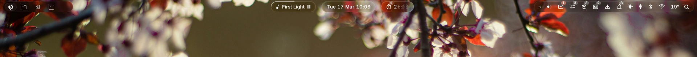
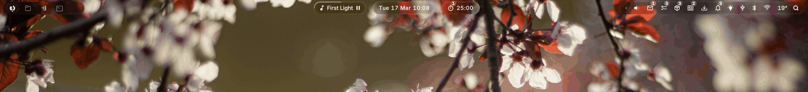
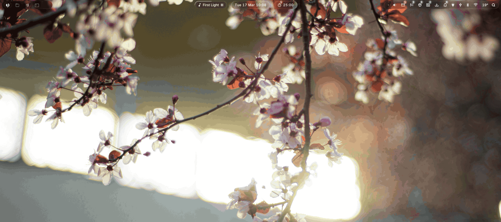
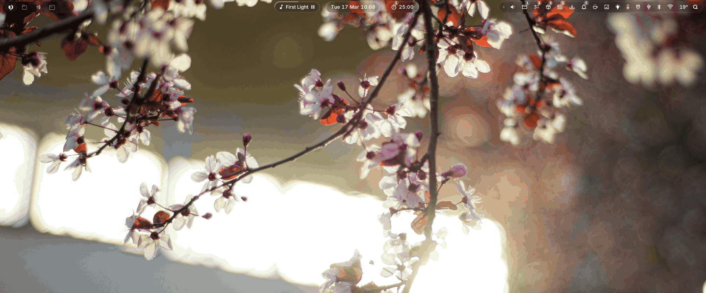
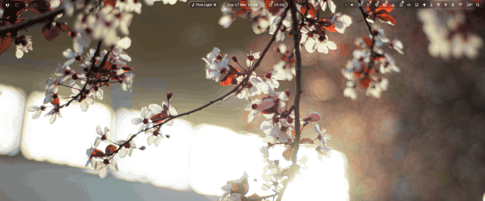

#  dewdrop

A glass bar and keyboard launcher for Hyprland, written in [Quickshell](https://quickshell.org). Pills merge around the clock, the workspace mark bounces at the edges, and the wallpaper moves behind the glass.



## A Bar That Moves

Switch workspaces to send the glass selection mark across your apps. The wallpaper follows with parallax. Drag a window onto another workspace or scroll across the strip to switch.

[](docs/media/workspaces.webm)

Quiet controls fold into the right drawer. Music and timers merge into the clock, expand when you need them, and shift aside for notifications. Drag modules to rearrange them and pin your favourites.

[](docs/media/pills.webm)

## One Launcher For The Everyday Stuff

Launch apps, preview files, switch windows and search your clipboard. Read mail in place, browse your music, do a calculation, or type a task, timer, alarm or calendar event. Type `?` to browse the modes.

[](docs/media/launcher-tour.webm)

## Popovers Within Reach

Check your calendar, clear mail, tick off tasks and catch up on feeds without opening another window. Popovers grow from the bar and support keyboard navigation.

[](docs/media/popovers-productivity.webm)

Weather, per-app volume, Wi-Fi, Bluetooth and system controls live in the same place. Search settings to change the layout, fonts or motion, including Reduce Motion and Reduce Transparency.

[](docs/media/popovers-controls.webm)

All demos use fictional content. Click a GIF for its 60 fps video. [Screenshots and videos](docs/media/README.md).

## Install

Dewdrop is a personal config built on Arch Linux. It needs Quickshell 0.3.2 or newer and Hyprland 0.56 or newer with a Lua config (`hyprland.lua`).

### 1. Install The Base Packages

In an existing Hyprland session, install [Quickshell from Arch's official repository](https://archlinux.org/packages/extra/x86_64/quickshell/) and the base tools and fonts:

```sh
sudo pacman -Syu --needed quickshell git python pipewire pipewire-pulse wireplumber libpulse libnotify xdg-utils imagemagick coreutils ttf-nerd-fonts-symbols inter-font ttf-iosevkaterm-nerd foot
```

`foot` is the fallback terminal; kitty, alacritty and ghostty are also detected. Keep your existing terminal if you have one.

### 2. Get Dewdrop

If `~/.config/quickshell` already contains another config, move it aside first.

```sh
git clone https://github.com/tkutsu/dewdrop ~/.config/quickshell
```

### 3. Connect It To Hyprland

Add the integration near the top of `~/.config/hypr/hyprland.lua`, before your own overrides:

```lua
dofile(os.getenv("HOME") .. "/.config/quickshell/hypr/dewdrop.lua")
```

This supplies the blur, popup dismissal and workspace helpers. It also closes gaps in numbered workspaces as they empty. Keep the top outer gap at 8 pixels so windows line up below the bar; for example, `hl.config({ general = { gaps_out = 8 } })` sets all sides to 8.

Add startup and a launcher shortcut to the same file. Pick another key if Super+Space is already taken; see [Hyprland's keybind syntax](https://wiki.hypr.land/configuring/core/binds/).

```lua
hl.on("hyprland.start", function()
    hl.exec_cmd("qs -n")
end)

hl.bind("SUPER + SPACE", hl.dsp.exec_cmd("qs ipc call launcher toggle"))
```

Reload the Hyprland config, then start Dewdrop in a terminal:

```sh
hyprctl reload
qs -n
```

### 4. Make It Yours

Open the gear in the bar to choose modules, your wallpaper folder and default apps. The first run creates `settings.json`; edits there reload on save. [The default settings](settings.default.json) explain each option.

Install [Themis Icons](https://github.com/tkutsu/themis-icons) for the monochrome app icons shown in the demos. Other themes work by changing the icon-theme pragma in `shell.qml`.

Optional features need their own tools or services. File search uses `fd`, the calculator uses `libqalculate`, and clipboard history uses `cliphist` with a running watcher. Mail, Tasks, Calendar and YouTube require your own Google OAuth client. The [setup guide](docs/setup.md#optional-features) covers those dependencies, [Google sign-in](docs/setup.md#google-setup) and the [launcher shortcuts](docs/setup.md#launcher-reference). [Android phone alarms](docs/automate-setup.md) have a separate tutorial.

## Troubleshooting

| Symptom | What To Check |
| --- | --- |
| The bar does not start | Run `qs -n` from a terminal inside Hyprland and read the first error. Check `qs --version` and `hyprctl version`. For a running instance, `qs log -t 80` shows recent messages. |
| It broke after a Qt update | [Quickshell must match the installed Qt libraries](https://github.com/quickshell-mirror/quickshell/blob/master/BUILD.md). Fully update Arch with `sudo pacman -Syu`; if you built Quickshell yourself, rebuild it against the updated Qt. |
| Glass looks flat, or outside clicks do not close popovers | Check that `hypr/dewdrop.lua` is loaded, reload Hyprland and check for config errors. Turn off Reduce Transparency in Dewdrop's settings if you want the glass effect. |
| Icons are boxes or look different | Install Symbols Nerd Font for glyphs and Themis Icons for the app icons shown here. Relaunch the bar after installing fonts or an icon theme. |
| A module is missing or clipboard history is empty | Check its visibility in Settings and its [optional dependencies](docs/setup.md#optional-features). Wi-Fi needs NetworkManager running when the bar starts. Clipboard history needs `wl-paste --watch cliphist store` running in your session. |
| Google features fail or ask to reconnect every week | Enable the relevant APIs in your Cloud project and follow [Google setup](docs/setup.md#google-setup). Google [expires these refresh tokens after 7 days in Testing](https://developers.google.com/identity/protocols/oauth2/#expiration). Run `scripts/gtasks-auth --check` from the repo to check the saved sign-in. |

## Development

`shell.qml` is the entry point. The editable defaults and this machine's
`settings.json` stay beside it.

| Directory | Contents |
| --- | --- |
| `src/core/` | Settings, theme, paths and shared shell state |
| `src/bar/` | Bar layout and pill ordering |
| `src/components/` | Shared controls, popups and visual effects |
| `src/modules/` | Bar modules, launcher and settings windows |
| `src/services/` | Desktop integrations and data services |
| `src/lib/` | Shared JavaScript helpers |
| `assets/` | Icons, shaders and sounds |
| `scripts/` | Runtime helpers and maintenance tools |
| `tests/` | Regression checks, fixtures and the fresh-install runner |
| `docs/` | Setup guides and demo media |

Run a check from the checkout with `python3 tests/test-popup-standards.py`,
for example. `python3 tests/test-shell-load.py` compiles the real entry point
and its imports without creating the desktop windows; it needs a Wayland
connection for Quickshell's window types.

## License

[MIT](LICENSE). Bundled icons and the alarm sound retain their own licenses; see [icon credits](assets/icons/README.md).
