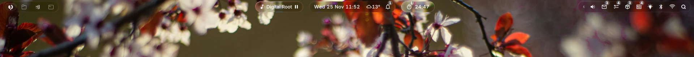
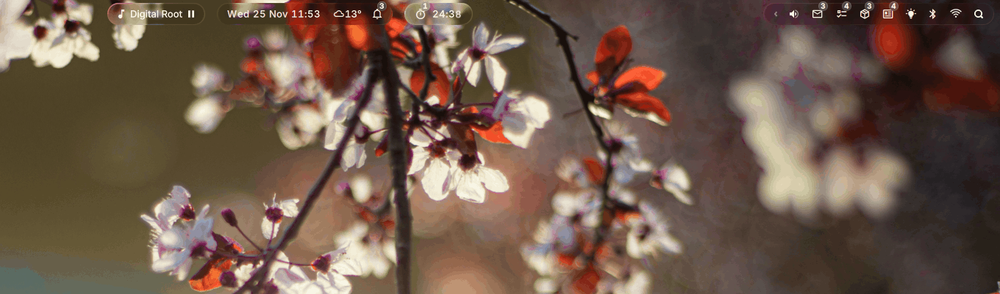
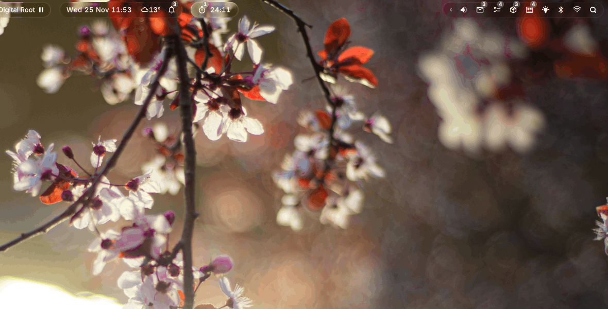

#  dewdrop

A glass bar and keyboard launcher for Hyprland, built with [Quickshell](https://quickshell.org). It's the bar I use every day.



## The Bar

Switch workspaces and a glass mark slides over to the new one, bouncing a little when it hits either end. The wallpaper drifts along behind it. You can also scroll over the strip to switch, or drag a window onto another workspace.


Controls you don't reach for often fold into a drawer on the right. Drag modules around to reorder them, and pin the ones you want to keep in view.


Music and timers merge into the clock, open up when you need them, and slide out of the way when a notification comes in.


## The Launcher

One shortcut for most of the small stuff: open apps, preview files, jump to a window, search your clipboard, read mail right there, browse your music, do some quick maths, or type in a task, timer, alarm or calendar event. Type `?` to see every mode.


## Popovers

Calendar, mail, tasks and feeds open in popovers that grow out of the bar, so checking them doesn't mean opening another window. They all work from the keyboard.



Weather, per-app volume, Wi-Fi, Bluetooth and the system controls are there too. Settings are searchable and cover the layout, fonts and motion, with Reduce Motion and Reduce Transparency for when the bouncing and the glass get to be too much.



Dewdrop is also your polkit agent. When `pkexec` or an app needs an administrator's password, it asks in a small glass panel, and shakes it if the password is wrong.

## The Lock Screen

Locking fades your windows into the wallpaper and raises a pane of glass with the time, the weather, what notified while you were away and the password field. The wallpaper drifts a little after the pointer. Settings > Lock Screen chooses what the glass shows and how its date, time and weather read, and has a PIN Mode that checks the password without Return once it is as long as the length you give it.

## Install

Dewdrop is my personal config, and I run it on Arch Linux. It needs Quickshell 0.3.2 or newer and Hyprland 0.56 or newer with a Lua config (`hyprland.lua`).

### 1. Install The Base Packages

In an existing Hyprland session, install [Quickshell from Arch's official repository](https://archlinux.org/packages/extra/x86_64/quickshell/) and the base tools and fonts:

```sh
sudo pacman -Syu --needed quickshell git python pipewire pipewire-pulse wireplumber libpulse libnotify xdg-utils imagemagick coreutils ttf-nerd-fonts-symbols inter-font ttf-iosevkaterm-nerd foot
```

`foot` is the fallback terminal; kitty, alacritty and ghostty are also detected. Keep your existing terminal if you have one.

### 2. Get Dewdrop

If `~/.config/quickshell` already contains another config, move it aside first.

```sh
git clone https://github.com/tkutsu/dewdrop ~/.config/quickshell
```

### 3. Connect It To Hyprland

Add the integration near the top of `~/.config/hypr/hyprland.lua`, before your own overrides:

```lua
dofile(os.getenv("HOME") .. "/.config/quickshell/hypr/dewdrop.lua")
```

This supplies the blur, popup dismissal and workspace helpers. It also closes gaps in numbered workspaces as they empty. If you have your own Escape or close-window binds, see [Escape and close keybinds](docs/setup.md#escape-and-close-keybinds) so they leave the launcher and settings alone. Keep the top outer gap at 8 pixels so windows line up below the bar; for example, `hl.config({ general = { gaps_out = 8 } })` sets all sides to 8.

To start Dewdrop with Hyprland, add an exec line to the same file. It runs once each time Hyprland starts, and `-n` makes it do nothing if Dewdrop is already running:

```lua
hl.on("hyprland.start", function()
    hl.exec_cmd("qs -n")
end)
```

Then add a shortcut for the launcher. Pick another key if Super+Space is already taken; see [Hyprland's keybind syntax](https://wiki.hypr.land/configuring/core/binds/).

```lua
hl.bind("SUPER + SPACE", hl.dsp.exec_cmd("qs ipc call launcher toggle"))
```

Dewdrop is also your polkit agent, and only one agent can run per session. Remove the line that starts your old one, wherever your config keeps its exec lines: `hyprland.lua` itself, or a file it loads such as `exec.lua`. Common agents are `polkit-kde-authentication-agent-1`, `hyprpolkitagent`, `polkit-gnome-authentication-agent-1` and `lxpolkit`. If a package such as `hyprpolkitagent` runs as a systemd user service instead, turn it off with `systemctl --user disable --now hyprpolkitagent`.

Dewdrop has its own lock screen, so it takes over from hyprlock or any other locker. Point your lock shortcut at it, replacing the bind that ran `hyprlock`:

```lua
hl.bind("SUPER + ESCAPE", hl.dsp.exec_cmd("qs ipc call lock lock"))
```

If you use hypridle, replace its `lock_cmd` (often `pidof hyprlock || hyprlock`) so idle locking and `loginctl lock-session` use Dewdrop too, and lock before sleep so a wake never opens on the desktop:

```ini
# ~/.config/hypr/hypridle.conf, under general
lock_cmd = qs ipc call lock lock
before_sleep_cmd = loginctl lock-session
```

Log out and back in, and the bar comes up with Hyprland, with no other polkit agent beside it.

### 4. Make It Yours

Open the gear in the bar to choose modules, your wallpaper folder and default apps. The first run creates `settings.json`; edits there reload on save. [The default settings](settings.default.json) explain each option.

Install [Themis Icons](https://github.com/tkutsu/themis-icons) for the monochrome app icons in the GIFs above. Other themes work by changing the icon-theme pragma in `shell.qml`.

Optional features need their own tools or services. File search uses `fd`, the calculator uses `libqalculate`, and clipboard history uses `cliphist` with a running watcher. Mail, Tasks, Calendar and YouTube require your own Google OAuth client. The [setup guide](docs/setup.md#optional-features) covers those dependencies, [Google sign-in](docs/setup.md#google-setup) and the [launcher shortcuts](docs/setup.md#launcher-reference). [Android phone alarms](docs/automate-setup.md) have a separate tutorial.

## Troubleshooting

| Symptom | What To Check |
| --- | --- |
| The bar does not start | Run `qs -n` from a terminal inside Hyprland and read the first error. Check `qs --version` and `hyprctl version`. For a running instance, `qs log -t 80` shows recent messages. |
| It broke after a Qt update | [Quickshell must match the installed Qt libraries](https://github.com/quickshell-mirror/quickshell/blob/master/BUILD.md). Fully update Arch with `sudo pacman -Syu`; if you built Quickshell yourself, rebuild it against the updated Qt. |
| Glass looks flat, or outside clicks do not close popovers | Check that `hypr/dewdrop.lua` is loaded, reload Hyprland and check for config errors. Turn off Reduce Transparency in Dewdrop's settings if you want the glass effect. |
| A password prompt comes from another app, or none comes at all | Only one polkit agent can run per session. Remove other agents from your exec lines, such as `polkit-kde-authentication-agent-1` or `hyprpolkitagent`, then restart Hyprland. If Dewdrop could not register, `qs log -t 80` shows a polkit warning. |
| Icons are boxes or look different | Install Symbols Nerd Font for glyphs and Themis Icons for the app icons shown here. Relaunch the bar after installing fonts or an icon theme. |
| A module is missing or clipboard history is empty | Check its visibility in Settings and its [optional dependencies](docs/setup.md#optional-features). Wi-Fi needs NetworkManager running when the bar starts. Clipboard history needs `wl-paste --watch cliphist store` running in your session. |
| Google features fail or ask to reconnect every week | Enable the relevant APIs in your Cloud project and follow [Google setup](docs/setup.md#google-setup). Google [expires these refresh tokens after 7 days in Testing](https://developers.google.com/identity/protocols/oauth2/#expiration). Run `scripts/gtasks-auth --check` from the repo to check the saved sign-in. |

## License

[MIT](LICENSE). Bundled icons and the alarm sound retain their own licenses; see [icon credits](assets/icons/README.md).
